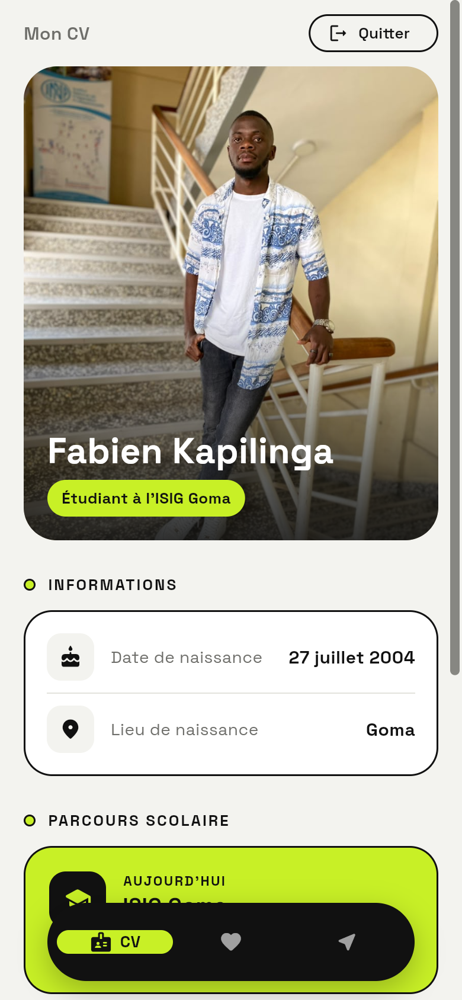
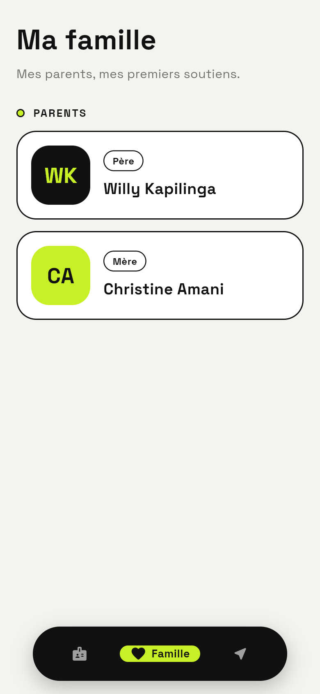
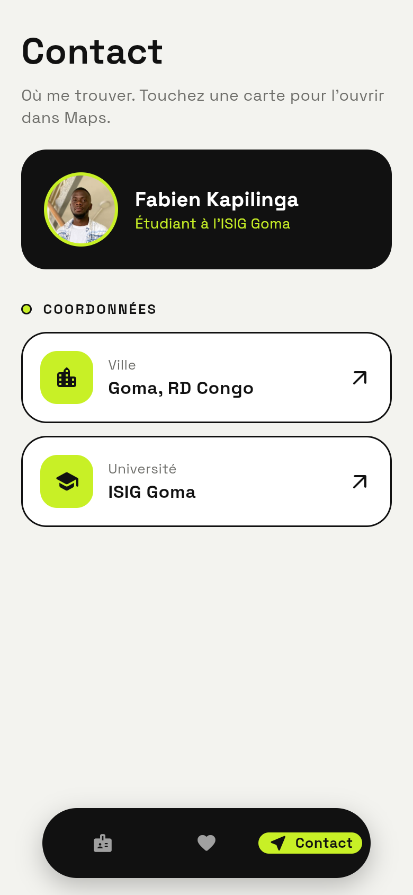

# CV Flutter – Fabien Kapilinga

Application mobile Flutter qui présente mon CV, ma famille et mes coordonnées.
L'accès à l'application se fait par une page de connexion.

## Fonctionnalités

- **Connexion** : formulaire avec identifiant, mot de passe masqué (affichable via l'icône œil) et bouton « Se connecter ». Un message s'affiche si les identifiants sont incorrects.
- **CV** : photo, nom, statut d'étudiant, informations personnelles et parcours scolaire.
- **Famille** : mes parents, présentés dans des `Card` avec leur nom et leur lien de parenté.
- **Contact** : ma ville et mon université, cliquables pour les ouvrir dans Google Maps grâce à `url_launcher`.
- **Navigation** : une barre de navigation flottante en bas de l'écran (CV, Famille, Contact) et un bouton de déconnexion.

## Identifiants de test

| Identifiant | Mot de passe |
|-------------|--------------|
| `fabien`    | `fabien2026` |

## Captures d'écran

### 1. Page de connexion


### 2. Page d'accueil (CV)

| Profil | Informations & parcours |
|:---:|:---:|
|  |  |

### 3. Page Famille



### 4. Page Contact



## Technologies

- Flutter / Dart (Material 3)
- [`google_fonts`](https://pub.dev/packages/google_fonts) : police Space Grotesk
- [`url_launcher`](https://pub.dev/packages/url_launcher) : ouverture de la carte

## Lancer le projet

```bash
flutter pub get
flutter run
```

## Auteur

**Fabien Kapilinga** – Étudiant à l'ISIG Goma (RDC)
