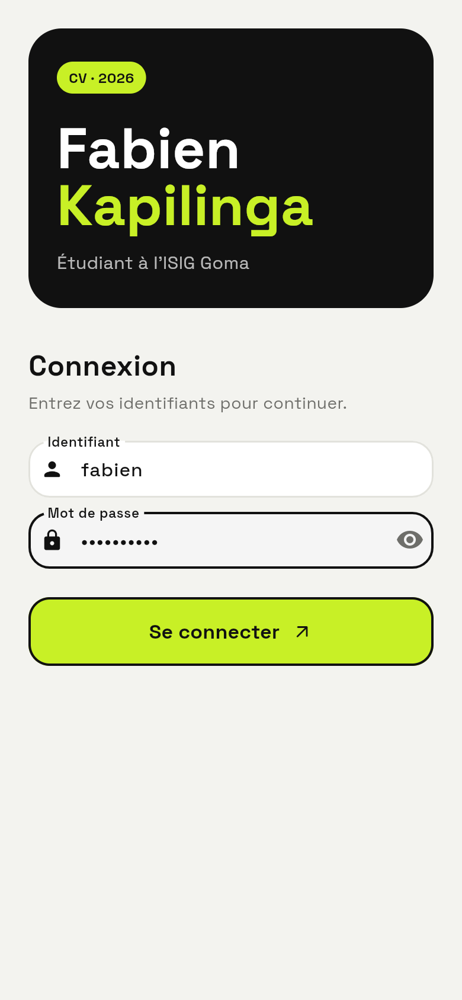
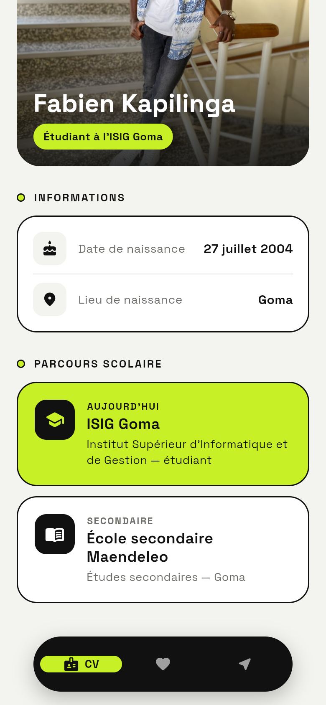
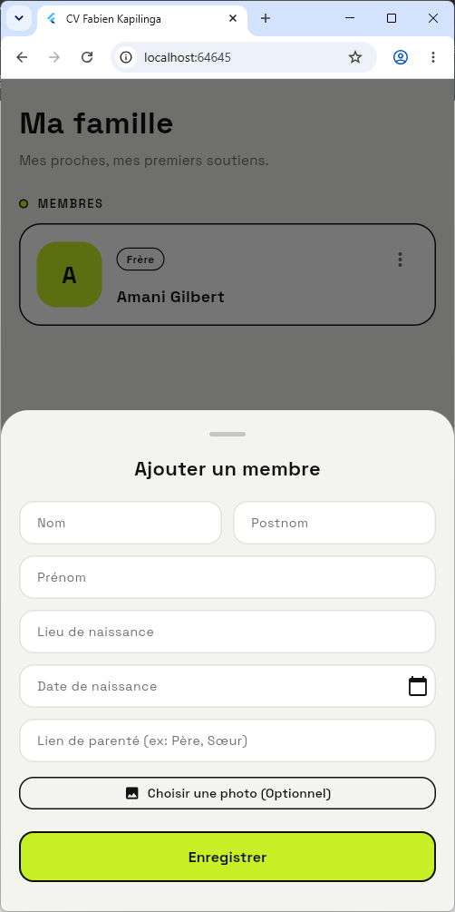
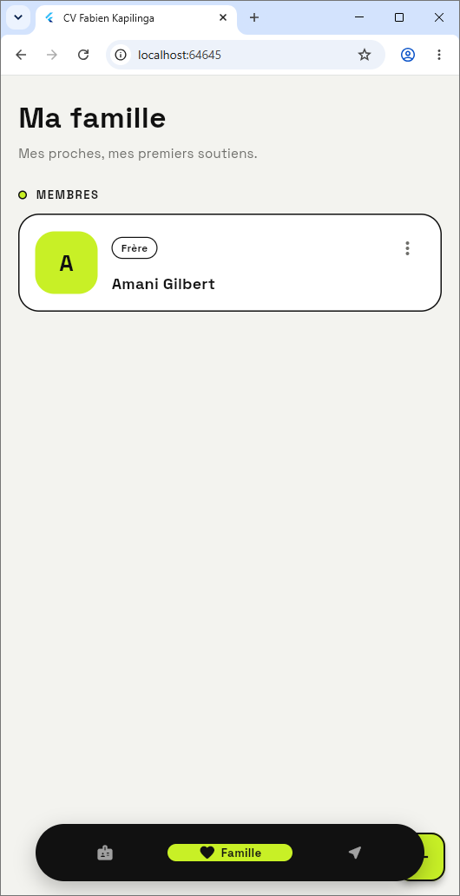
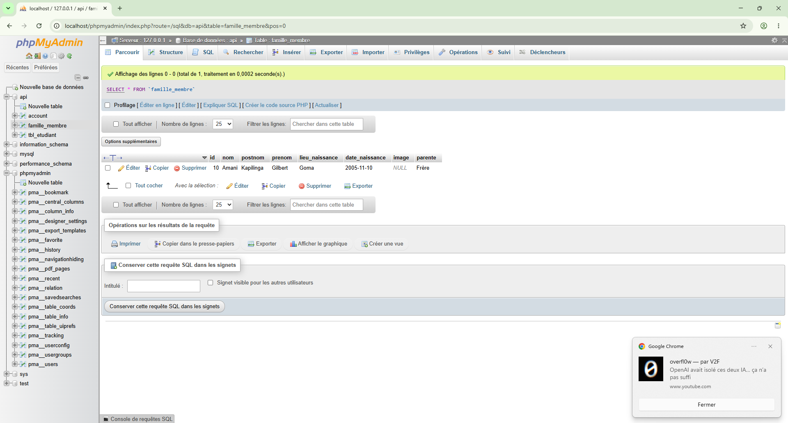

# CV Flutter – Fabien Kapilinga (Dynamique)

Application mobile Flutter complète présentant le CV de Fabien Kapilinga, avec authentification réelle et gestion dynamique des membres de la famille via une API REST et une base de données MySQL.

## Fonctionnalités

- **Authentification** : Connexion sécurisée via l'API (`/accounts/login`).
- **CV** : Photo, nom, statut d'étudiant, informations personnelles et parcours scolaire.
- **Famille (CRUD)** : Ajout, consultation, modification et suppression des membres de la famille en temps réel (avec gestion des photos et sélection de la date de naissance).
- **Contact** : Ville et université, cliquables pour être ouverts dans Google Maps.
- **Navigation** : Barre de navigation flottante (CV, Famille, Contact) et bouton de déconnexion.

## Identifiants de test

Pour vous connecter, utilisez un compte créé via l'API :
| Identifiant (Email) | Mot de passe |
|---------------------|--------------|
| `fabien@exemple.com`| `fabien2026` |

*(Si ce compte n'existe pas dans votre base de données locale, créez-le via Postman en envoyant une requête POST sur `/accounts/register`)*.

## Configuration requise

### 1. Base de données & API (XAMPP)
1. Démarrez **Apache** et **MySQL** depuis XAMPP.
2. Ouvrez `http://localhost/phpmyadmin`, créez une base `api` et importez le fichier `api.sql`.
3. Placez le dossier de l'API dans `C:\xampp\htdocs\api-test`.
4. L'API est accessible sur `http://localhost/api-test/public`.

### 2. Application Flutter
1. Clonez ce dépôt.
2. Exécutez `flutter pub get`.
3. Lancez l'application avec `flutter run`.

**Note pour l'émulateur Android** : L'URL de l'API est configurée sur `http://10.0.2.2/api-test/public`. Pour un appareil physique ou le web, modifiez la constante `kBaseUrl` dans `lib/main.dart`.

## Captures d'écran

### 1. Page de connexion

### 2. Page d'accueil (CV)
| Profil | Informations & parcours |
|:---:|:---:|
|  |  |

### 3. Page Famille (Dynamique API)
**Liste des membres :**

**Formulaire d'ajout / modification :**

### 4. Page Contact

### 5. Base de données MySQL (phpMyAdmin)

---

## Démonstration Vidéo

*Vidéo montrant l'application Flutter communiquer avec l'API et la base de données en temps réel.*

<video src="screenshots/video_demo.mp4" controls="controls" style="max-width: 100%;">
Votre navigateur ne supporte pas la balise vidéo.
</video>

*Si la vidéo ne s'affiche pas, [téléchargez-la ici](screenshots/video_demo.mp4).*

## Technologies

- Flutter / Dart (Material 3)
- `http` : Requêtes API
- `google_fonts` : Police Space Grotesk
- `url_launcher` : Ouverture de la carte
- `image_picker` : Sélection d'images
- `intl` : Formatage des dates

## Auteur

**Fabien Kapilinga** – Étudiant à l'ISIG Goma (RDC)